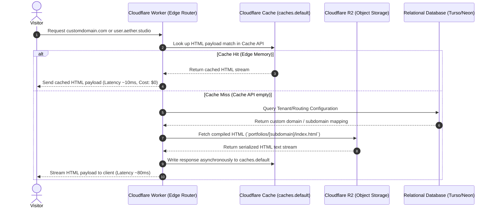

# Aether Studio Architecture & Development Guide

This document details the architecture, file structure, code conventions, and maintainability guidelines for the Aether Studio multi-tenant portfolio platform.

---

## 1. Project Directory Structure

```
/aether-studio
├── /docs                            # Project plans, architecture, and developer guides
│   ├── plan.md                      # Original project roadmap
│   └── architecture.md              # [This File] Architecture & best practices documentation
├── /src                             # Next.js Application Root
│   ├── /app                         # App Router File Conventions
│   │   ├── /api                     # API Route Handlers
│   │   │   ├── /publish             # Compiler execution & R2 publisher endpoint
│   │   │   └── /upload-url          # Pre-signed R2 asset upload url generator
│   │   ├── /dashboard               # Builder UI canvas & version-reconciliation workspace
│   │   │   └── /projects            # Projects Overview Dashboard (subdomains & analytics)
│   │   ├── globals.css              # Main tailwind and layout global styles
│   │   ├── layout.tsx               # Root app router layout structure
│   │   └── page.tsx                 # Landing / Landing Redirection page
│   ├── /components                  # Reusable React components
│   │   ├── /builder                 # Drag & drop layout tree components
│   │   │   └── /right-sidebar       # Decomposed style, content, page settings, and color-picker panels
│   │   └── /registry                # Static component registry elements and graphic mockups
│   ├── /hooks                       # Extracted modular canvas, sync, publish, and toast state custom hooks
│   ├── /lib                         # Shared services & utility modules
│   │   ├── /compiler                # HTML serialization engine, shared style utilities (style-utils.ts), and centralized scale maps (style-maps.ts)
│   │   ├── /db                      # Relational Database connection wrapper (Turso/Neon)
│   │   ├── /kv                      # Vercel KV cache & backup client
│   │   ├── /r2                      # AWS SDK R2 Client bucket integration
│   │   └── /telemetry               # Sentry exceptions and custom tracing helpers
│   ├── /types                       # Unified builder typings contract definition file (builder.ts)
│   └── proxy.ts                     # Next.js 16 pre-request interceptor boundary
├── /workers                         # Cloudflare Edge Worker microservices
│   ├── /subdomain-router            # Routing engine using Cache API (caches.default)
│   └── /edge-forms                  # Edge data submissions processor (Turnstile/media disabled in basic-only mode)
├── eslint.config.mjs                # ESLint code styling configuration
├── next.config.ts                   # Next.js bundler and compiler settings
├── postcss.config.mjs               # PostCSS styles compiler configurations
├── tsconfig.json                    # TypeScript strict rules configurations
├── wrangler.toml                    # Local edge emulation setup (Miniflare mapping)
└── package.json                     # Node.js dependencies
```

---

## 2. Request Lifecycle & Caching Architecture

This diagram illustrates how requests flow through the Aether Studio architecture to minimize database and serverless costs.



---

## 3. Technology Stack Best Practices

### A. Next.js 16 App Router & Proxy Boundaries
- **Use `proxy.ts` ([src/proxy.ts](file:///home/zors/Git%20repositories/aether-studio/src/proxy.ts))**: The `middleware` file convention is deprecated in Next.js 16. Always implement interceptors inside `src/proxy.ts` using the `proxy()` function.
- **Node.js Runtime by Default**: Unlike earlier versions where middleware ran on Edge, Proxy defaults to the Node.js runtime. This allows imports of standard Node modules directly in `proxy.ts`, but care must be taken to keep execution overhead minimal.
- **Keep Matchers Declarative**: Matchers in the proxy `config` must remain static arrays of strings so they can be parsed at build-time.

### B. Local-First State & Synchronization
- **Canvas Debouncing**: Debounce canvas state writes to `localStorage` at 100ms on the main thread to ensure smooth drag-and-drop frames.
- **BroadcastChannel API**: Broadcast a version timestamp message across tabs on state mutation:
  ```ts
  const channel = new BroadcastChannel('aether_canvas_sync');
  channel.postMessage({ type: 'STATE_MUTATED', timestamp: Date.now() });
  ```
- **KV Synchronizer**: Write drafts to Vercel KV using a 15-second interaction debounce. Implement `visibilitychange` and `beforeunload` events to trigger immediate, non-blocking synchronous flushes before the browser tab closes.
- **Undo/Redo & Time-Travel Engine**: Maintains a chronological state history stack of visual mutations on the canvas. Supports global keyboard hotkeys (`Cmd/Ctrl + Z` for undo, `Cmd/Ctrl + Shift + Z` or `Cmd/Ctrl + Y` for redo) with automatic input-filtering overrides to prevent collisions during text editing. Diffs between successive state elements are compiled on-the-fly to generate descriptive labels (e.g., "Add headline", "Delete button", "Reorder Blocks") for chronological state time travel.
- **Device Style Breakpoint Overrides**: Merges nested styling overrides (`mobile` and `tablet` objects) dynamically on the client canvas depending on the active view size. At publish-time, the compiler maps these to media-query-wrapped CSS rules targeting element IDs, ensuring maximum specificity over Tailwind classes and base styles.
- **Component Tree Hierarchy**: Canvas elements may carry an optional display `name` and `parentId`. The Layers panel renders these relationships beneath a page root, keeps its selection synchronized with the canvas, and commits renaming, duplication, and sibling-only reordering through the same history stack. Deleting a parent removes its descendants to prevent orphaned nodes.

### C. Cloudflare R2 & Media Management
- **Pre-signed Direct Uploads**: Never upload images through Next.js API routes or base64 serialization in `localStorage`. Request a pre-signed URL from Next.js (`/api/upload-url`) and have the browser perform a direct PUT request to the R2 bucket.
- **Cache-Control Headers**: When publishing pages to R2, always append long-term cache headers to the object metadata:
  ```http
  Cache-Control: public, max-age=31536000, s-maxage=31536000, immutable
  ```

---

## 4. Codebase Maintainability & Scalability Guidelines

As the codebase approaches larger sizes, maintain strict separation of concerns:

### 1. Zero Dependency Coupling in Shared Libraries
Ensure files inside [src/lib/](file:///home/zors/Git%20repositories/aether-studio/src/lib/) do not import React components or UI libraries. They should be clean, testable TypeScript utilities focusing on single responsibilities (e.g., [src/lib/compiler/](file:///home/zors/Git%20repositories/aether-studio/src/lib/compiler/index.ts) parses JSON to HTML, independent of DOM or React dependencies).

### 2. Centralized Style Scale Maps
All spacing, font-size, border-radius, font-weight, letter-spacing, and layout scale maps live in **one place**: [`src/lib/compiler/style-maps.ts`](file:///home/zors/Git%20repositories/aether-studio/src/lib/compiler/style-maps.ts). Both the runtime compiler (`compiler.ts`) and the live canvas style utilities (`style-utils.ts`) import from this single source of truth. Never re-declare a `Record<string, string>` scale map inline in any other file — update `style-maps.ts` instead.

### 3. Shared UI Sub-components via Colocation
Reusable UI patterns that appear in more than one component **must** be extracted to a shared sub-component rather than copy-pasted:
- **`<FontPicker>`** ([src/components/builder/right-sidebar/font-picker.tsx](file:///home/zors/Git%20repositories/aether-studio/src/components/builder/right-sidebar/font-picker.tsx)): Encapsulates the full Google Fonts search dropdown with smart directional positioning. Used by both `StyleInspectorTab` and `PageSettingsTab`.
- **Modal components**: Page-level modals are colocated as presentational components in a `_components/` directory next to the page that owns their state (e.g., `PublishModal`, `ViewHtmlModal` in `app/dashboard/_components/`). The parent page retains all state and passes data + callbacks as props.

### 4. Hook State Helpers
Private helpers inside custom hooks should be extracted as inner functions to eliminate copy-paste. Example: `syncSelectedElement(snapshot)` in `useCanvasState` centralizes the 3-line selection-sync block shared by `handleUndo`, `handleRedo`, and `handleJumpToHistoryStep`.

### 5. Deterministic Design System Registry
Define all atomic layout widgets as static, immutable component schemas. Translation to inline HTML style attributes must be handled deterministically inside the Registry component layer, mapping to Tailwind utility properties present inside the centralized `aether-core.min.css`.

### 6. Edge Worker Isolation
Keep Cloudflare Worker microservices in the [workers/](file:///home/zors/Git%20repositories/aether-studio/workers/) folder fully isolated. Do not share imports between Next.js frontend code and Worker scripts, as the execution environments and bundler configurations differ.

---

## 5. Coding Practices & Clean Code Guidelines

To keep the codebase readable, performant, and maintainable as it grows, adhere to the following rules:

### A. Strict Type Safety
- **No Implicit `any`**: Ensure `tsconfig.json` has `strict: true` active. Avoid using `any` types; prefer generics or `unknown` with type guards.
- **Strict Contract Interfaces**: Define exact types or interfaces for every data structure exchanged between the frontend, Vercel KV, and the Turso relational database (e.g., the visual builder Rose Tree structure).
- **Discriminated Unions**: Use discriminated unions for action handlers and state reducer actions to prevent invalid state configurations.

### B. React Component Architecture
- **Server Components by Default**: All layout and page templates must be Server Components. Use Client Components (`"use client"`) only for visual builder canvas elements, custom inputs, modal interactions, or browser-only hooks (e.g. `useEffect`, `useState`).
- **Colocate Assets**: Store page-specific sub-components, types, tests, and utility functions in the same directory as their main component (colocation) rather than using a global dump folder.
- **Keep Components Focused**: Keep individual React components under 200 lines. Break large UI panels into sub-components, separating presentation layout from logical canvas state handlers.
- **State and Ref Synchronization (React 19)**: Avoid calling state setters synchronously inside `useEffect` bodies, as this triggers cascading renders. Instead, adjust state during rendering or use event handlers. Do not read or write ref values (`ref.current`) during rendering; update refs in effects (`useEffect`) or in event handlers to keep render methods pure.

### C. Styling Rules
- **No Ad-Hoc Tailwind Arbitrary Values**: Avoid values like `bg-[#f0f0f0]` or `w-[113px]`. Use standardized theme tokens (e.g. `bg-slate-900`, `w-28`) mapped to your design variables, ensuring visual design consistency.
- **Pure CSS Overrides**: Custom customer overrides on portfolios are compiled and dynamically written into inline HTML styles as computed token variables (e.g., `style={{ '--accent-color': userChoice } as React.CSSProperties}`).

### D. Resilient Error Boundaries & Fallbacks
- **UI Canvas Protection**: Wrap every visual block component rendered on the workspace builder canvas in a React Error Boundary. A crash in a custom element (e.g., a broken image block layout) must not crash the parent builder canvas.
- **Fail-Safe Persistence**: If remote synchronization (Vercel KV or Turso database calls) fails due to network issues or API rate limits, catch the errors gracefully, show a subtle warning banner, and fall back to the browser's local storage cache to protect user data.

### E. Environment Variable Validation
- **Fail-Fast Configuration**: Validate all process environment variables (such as R2 credentials, KV connection tokens, and Database connection strings) at server runtime startup. Use a schema library like `zod` to throw descriptive errors instantly if a variable is missing or formatted incorrectly:
  ```ts
  import { z } from 'zod';
  const envSchema = z.object({
    DATABASE_URL: z.string().url(),
    R2_BUCKET_NAME: z.string(),
  });
  export const env = envSchema.parse(process.env);
  ```

### F. API Route Design & Consistent Responses
- **Uniform JSON Envelope**: Ensure all route handlers and server actions return responses wrapped in a uniform contract structure:
  ```ts
  interface ApiResponse<T = any> {
    success: boolean;
    data?: T;
    error?: {
      message: string;
      code: string;
    };
  }
  ```
- **Proper HTTP Status Codes**: Explicitly return correct HTTP response statuses (`200 OK`, `400 Bad Request`, `401 Unauthorized`, `403 Forbidden`, `500 Server Error`) instead of wrapping failures in 200 responses.

### G. Testing & Emulation Strategy
- **Unit Testing**: Focus unit testing (using Vitest or Jest) on core functional pure-logic utilities like the visual-tree compiler ([src/lib/compiler/](file:///home/zors/Git%20repositories/aether-studio/src/lib/compiler/index.ts)) and registries.
- **Integration & E2E Testing**: Use Playwright or Cypress for testing visual canvas drag-and-drop mechanics, broadcast synchronization, and database interaction.
- **Edge Emulation**: Utilize `wrangler dev` (backed by Miniflare) to run local, isolated integration tests for Cloudflare Workers, R2 local directories, and local Cache API simulation before pushing code to production.

---

## 6. Clean Coding Principles & Naming Conventions

To guarantee consistency across all modules and contributors, follow these naming conventions and design principles strictly:

### A. Naming Conventions

| Category | Convention | Examples |
| :--- | :--- | :--- |
| **Variables & Functions** | `camelCase` | `canvasState`, `compileLayout`, `handleSync()` |
| **React Components** | `PascalCase` | `VisualCanvas`, `BuilderNavbar`, `SettingsPanel` |
| **TS Types & Interfaces** | `PascalCase` | `CanvasStateProps`, `RegistryMap`, `ApiResponse` |
| **Constants & Env Vars** | `UPPER_SNAKE_CASE` | `MAX_RETRY_LIMIT`, `DATABASE_URL`, `DEBOUNCE_MS` |
| **Files & Folders** | `kebab-case` | `subdomain-router`, `upload-url`, `isomorphic-dompurify` |
| **Boolean Flags** | Prefix with indicator | `isPublished`, `hasChanges`, `shouldSync`, `canEdit` |

- **Descriptive & Non-Ambiguous Names**: Avoid naming things `temp`, `data`, or `obj`. Use descriptive names like `draftPayload`, `nodeElementMap`, or `pendingSyncTimer`.
- **Next.js Conventions**: Next.js App Router folders use directory structures corresponding to URLs, containing lower-case framework files (`page.tsx`, `layout.tsx`, `route.ts`). Keep custom client components and business hooks in `components/` and `lib/` to avoid polluting the route folders.

### B. Core Coding Principles

#### 1. Single Responsibility Principle (SRP)
Each component, module, or helper file must have exactly **one reason to change**.
- **Bad**: A React component that manages UI layout, makes database queries, and compiles HTML directly in its body.
- **Good**: The component renders the visual builder canvas; state logic is abstracted to a custom hook (`useCanvasState`), and compilation is delegated to the compiler library ([src/lib/compiler/](file:///home/zors/Git%20repositories/aether-studio/src/lib/compiler/index.ts)).

#### 2. DRY (Don't Repeat Yourself)
Avoid duplicating business logic. If a function or configuration (e.g. Turnstile token validation or pre-signed URL headers) is used in multiple routes or scripts, abstract it into the `lib/` directory or share the contract interfaces.

#### 3. KISS (Keep It Simple, Silly)
Avoid over-engineering canvas tree manipulation algorithms or rendering pipelines. Optimize for readable, standard TypeScript operations (like array mapping or recursive node searches) before writing complex custom data structures, unless performance metrics explicitly dictate it.

#### 4. YAGNI (You Aren't Gonna Need It)
Do not build complex features (such as custom sub-routing configurations or multi-datacenter replication APIs) until there is a clear requirement. Keep code focused on fulfilling the current phase requirements without adding unrequested abstraction layers.

#### 5. Principle of Least Privilege
Apply restricted permissions to database queries, pre-signed R2 uploads, and Cloudflare Worker environments. Only expose the absolute minimum data needed by the client. For example, API response schemas must filter out internal session tokens, user emails, or bucket configuration parameters.


